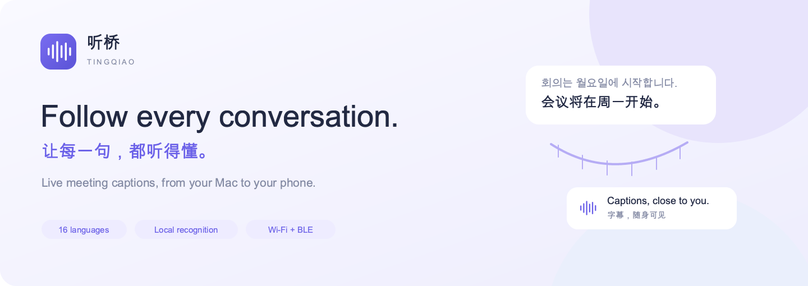
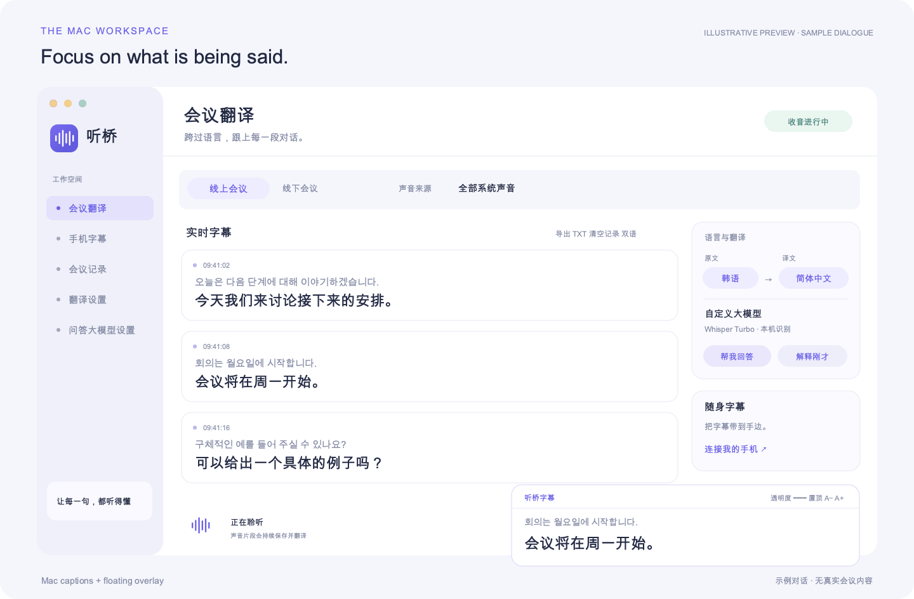
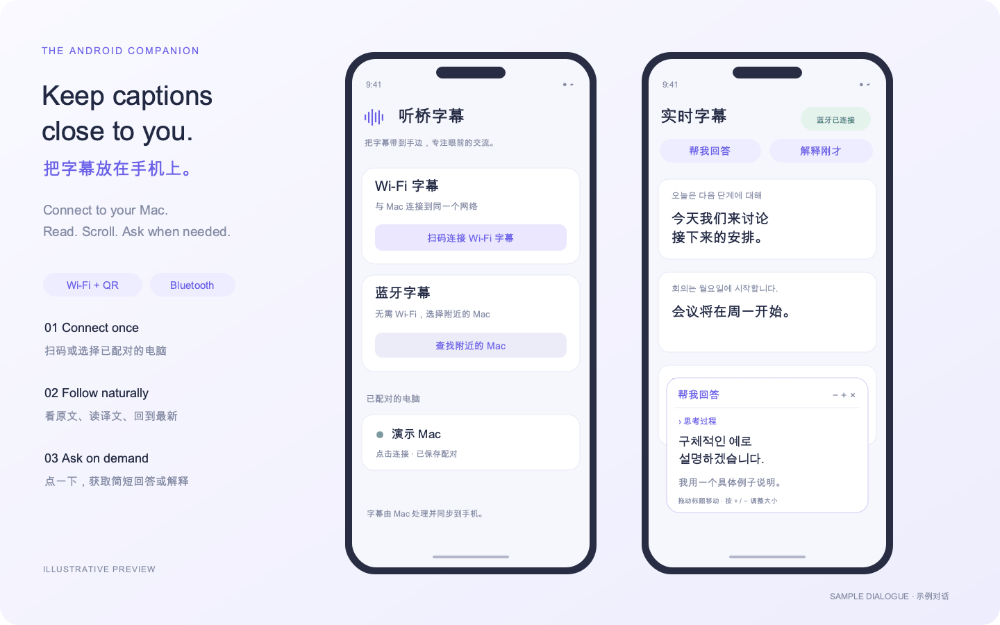
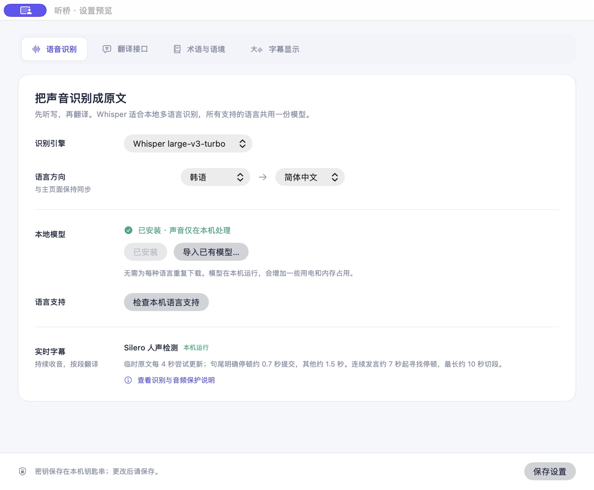

  

  <a href="README.md"><strong>English</strong></a> ·
  <a href="README.zh-CN.md">简体中文</a> ·
  <a href="#build-from-source">Build</a> ·
  <a href="docs/PRIVACY.md">Privacy</a>

  
  
  
  

**TingQiao (听桥)** brings live, bilingual captions to meetings and classes. Listen through your Mac's microphone or capture meeting audio, translate confirmed speech, and follow the conversation on your desktop or Android phone.

**听桥**是一款面向课堂与会议的实时字幕工具。支持麦克风与系统声音收音、多语言翻译，以及通过 Wi-Fi 或蓝牙把字幕同步到安卓手机上。[阅读中文介绍 →](README.zh-CN.md)

  

*Illustrative interface previews use fictional dialogue. They contain no real meeting records, pairing credentials, or saved API settings.*

## Made for the conversation

| | What you can do |
| --- | --- |
| **Two ways to listen** | Capture system or application audio for online meetings, or choose a built-in, USB, or Bluetooth microphone in person. |
| **16 language choices** | Choose source and target independently. Whisper uses one multilingual model for all choices. |
| **Your recognition engine** | Apple speech, Whisper Turbo, Whisper Medium KomixV2 (Korean), Whisper Large V3, or Qwen3-ASR-1.7B. Local models are downloaded separately. |
| **Your translation provider** | Google trial endpoint, Google Cloud Translation, Index-Translate, or a Chat Completions-compatible API. |
| **Context that stays in context** | Optionally send the preceding 1–6 segments to the translation model. Only the current segment becomes its subtitle. |
| **Captions where you need them** | A resizable desktop overlay with font, opacity, pinning, history scrolling, and follow-latest controls. Android receives captions over Wi-Fi or BLE. |
| **A reply when you ask** | Use five minutes of background to answer all questions in the latest 15 segments, or explain those 15 segments. Answers use the question’s language with a target-language translation. Set 1–3 sentences per answer; returned reasoning can collapse. |
| **Keep the useful parts** | Local transcript history, individual deletion, clear/undo, and TXT export. Audio segments are saved before processing. |

### Available languages

English · Korean · Japanese · Simplified Chinese · Traditional Chinese · Spanish · French · German · Portuguese · Italian · Russian · Arabic · Hindi · Indonesian · Vietnamese · Thai.

Apple recognition availability depends on macOS and installed language resources. In **Translation settings → Speech recognition**, check support, open system language settings, or manually install the current SpeechTranscriber language on macOS 26. Multilingual models share their downloaded weights across languages; KomixV2 is restricted to Korean.

## A phone-sized caption screen

  

- **Wi-Fi** — enable phone captions on the Mac, then scan its QR code or paste the complete pairing link into the Android app. A phone browser can also open the link.
- **Bluetooth** — enable BLE captions on the Mac. On Android, allow Nearby devices, select the Mac, and enter its six-digit code for the first connection. Saved per-device credentials support later reconnects and multiple paired computers.
- Tap either assistant button from the phone to request a response through the Mac's configured assistant API. Its reply panel can move and resize.
- Keep the caption screen in the foreground. Background execution and reconnect behaviour depend on the device and OS.

The Android app is the caption companion. Recognition, translation requests, API keys, and transcript storage live on the Mac.

## A short guided start

A five-step tour introduces capture, recognition, translation, phone captions, and the meeting assistant. **Next** opens the relevant menu and scrolls to its controls. Skip or close it at any time, then reopen it from **Usage guide** or the Help menu.

A cost-conscious starting point is **Whisper large-v3-turbo** for local recognition and **Moark / Gitee AI Hy-MT2-30B-A3B** for custom text translation, with four preceding segments of context. The personal usage reference is around **CNY 0.10 for two hours**. This is an estimate based on usage, not an hourly package or a guaranteed minimum. Actual cost depends on speaking volume, context, token usage, and provider prices. [Model and pricing](https://ai.gitee.com/serverless-api?model=Hy-MT2-30B-A3B)

Use a general conversation model, such as DeepSeek, for the separate assistant API. Start with low reasoning effort and a maximum of three sentences. Saved assistant keys show a fixed asterisk placeholder and a saved indicator when you return to settings. The real key stays in Keychain.

## Start a session

1. Open TingQiao and choose **online** or **in-person** mode.
2. Select the audio source, source language, and target language.
3. In **Translation settings**, choose recognition and translation providers. For a local engine, review its installation notice, then download or import that model once.
4. If needed, enter your API endpoint, model name, and key. The meeting assistant has independent API settings.
5. Start translating and allow the relevant macOS permissions.
6. Optionally connect the Android companion or open the floating caption window.

In online mode, TingQiao reads playback audio through ScreenCaptureKit and leaves microphone selection to the meeting app. It needs no virtual audio device. In-person mode uses the chosen microphone. Capture follows one selected path, with no dual-input acoustic echo cancellation.

## Download and install

[Get the latest packages](https://github.com/oswin-creator/tingqiao-realtime-translation/releases/latest) — no source build required.

| Platform | Download | Requirements |
| --- | --- | --- |
| Mac | [TingQiao 0.2.31 · DMG](https://github.com/oswin-creator/tingqiao-realtime-translation/releases/download/v0.2.31/TingQiao-macOS-arm64-0.2.31.dmg) | Apple silicon, macOS 14+ |
| Android companion | [TingQiao Captions 0.3.2 · APK](https://github.com/oswin-creator/tingqiao-realtime-translation/releases/download/v0.2.31/TingQiao-Captions-Android-0.3.2.apk) | Android 8+ |
| Integrity | [SHA-256 checksums](https://github.com/oswin-creator/tingqiao-realtime-translation/releases/download/v0.2.31/SHA256SUMS.txt) | Verify downloaded files |

Open the DMG and drag TingQiao to Applications. Install the APK on Android, or scan the Mac's Wi-Fi QR code with a phone camera and read captions directly in the browser. Mac and phone must share the same Wi-Fi for browser access.

The Mac preview uses a stable self-signed release identity and is not Apple-notarized. macOS may block its first launch. If you trust the download, follow [Apple's opening instructions](https://support.apple.com/en-us/102445). Android may request permission to install this APK source. See [installation help](docs/INSTALL.md).

Local ASR weights are downloaded separately from the sources shown in settings. Each model can be removed individually.

## What changed in 0.2.31

- Reduced workspace layout work during meter updates and manual caption scrolling.
- Main and floating windows keep their content dimensions during edge dragging, then reflow on release.
- **Check for updates** beside the version checks GitHub Releases, verifies the installer and signing identity, and installs when capture and other active work have ended.
- Stable self-signed release identity. The first upgrade from older ad-hoc builds may require audio permissions again; permission retention remains subject to macOS.

## Recognition models · 0.2.31

| Engine | Download | Installed | Language |
| --- | --- | --- | --- |
| Apple system speech | Managed by macOS | Managed by macOS | Depends on system resources |
| Whisper large-v3-turbo | 1.62 GB | 1.62 GB | Multilingual |
| Whisper Medium KomixV2 | 3.06 GB | About 1.53 GB | Korean |
| Whisper Large V3 | 3.10 GB | 3.10 GB | Multilingual |
| Qwen3-ASR-1.7B Q8 | 2.19 GB | 2.19 GB | Multilingual |

Model weights are not included in the installer. Each download has an installation notice, source link, progress, checksum validation, and an individual removal action. KomixV2 preserves byte-token encoding; existing affected files are repaired on first use without downloading the weights again.

Confirmed endings submit after about 0.7 seconds of silence, other endings after about 1.5 seconds. Continuous speech seeks a pause from 7 seconds, with a 10-second cap. Forced cuts carry 1.5 seconds into the next segment. Repetition checks preserve a usable preview and allow one clean-audio retry. [Release notes](docs/RELEASE-0.2.31.md).

## Settings and terminology

Translation settings now use four consistent tabs: recognition, translation API, terminology/context, and caption display. Save remains visible at the bottom. Detailed audio rules are available from one information button.

The app includes **14,160 Wikidata concepts** plus curated terms for statistics, difference-in-differences, and other fields. Select one or more professional fields before each session; saved selections are preselected next time. No extra terminology download or online lookup is required. Custom JSON import/export remains available; user terms take priority. A verified local update can replace the bundled snapshot.

Term hints augment Index and custom translation requests, not Whisper transcripts or the current Google interfaces. Only a few relevant terms are sent, capped at roughly 300 estimated tokens / 900 UTF-8 bytes. The pack has uneven language coverage; it is not a guarantee of correct translations. Data: Wikidata, CC0-1.0, snapshot 2026-11-06. See [terminology notes](docs/TERMINOLOGY.md).

## Build from source

The repository includes **Mac 0.2.31** and **Android 0.3.2** sources. Build output, Whisper recognition weights, credentials, and signing keys are excluded. The small licensed Silero detector and public Wikidata snapshot are included.

### Mac

Requirements: an Apple silicon Mac, macOS 14+, a recent Swift toolchain, Command Line Tools, CMake 3.20+, and Python 3. The SpeechAnalyzer code requires the **macOS 26 SDK or newer to compile**. Older systems use the legacy speech interface at runtime.

~~~sh
git clone https://github.com/oswin-creator/tingqiao-realtime-translation.git
cd tingqiao-realtime-translation
xcode-select --install
# If using Homebrew:
brew install cmake python
zsh build-whisper.sh
zsh build-qwen.sh
zsh build.sh
open build/听桥.app
~~~

The first helper build downloads a pinned whisper.cpp checkout and verifies its revision. Apple recognition can use already-installed system resources. Whisper weights are downloaded when you click **Download model**, or you can import a verified file.

Local builds use ad-hoc signing by default. To use an existing Apple signing identity, set TINGQIAO_SIGN_IDENTITY before building. Privacy permissions may require renewed approval after rebuilding. Developer ID signing and notarization are not provided by this repository.

### Android companion

Build on macOS with JDK 17, Android SDK Platform 35, and Build Tools 36.0.0. The lightweight build uses Android tools directly.

~~~sh
export ANDROID_SDK_ROOT="$HOME/Library/Android/sdk"
zsh android/build.sh
~~~

The build fetches ZXing Core 3.5.3 from Maven Central and verifies its SHA-256. Output is **android/build/听桥字幕.apk**. A local preview keystore is generated in the ignored build directory. The conventional preview password in the script is for this generated development key. Keep your own distribution signing key private.

### Tests

~~~sh
zsh test.sh
~~~

Tests use temporary stores, synthetic audio, mock API responses, and loopback ports. Java protocol tests require JDK 17. Device integration test sources are in android/tests and can be packaged with **zsh android/test-device.sh** after building the companion.

See [development notes](docs/DEVELOPMENT.md) for the source map, dependency versions, and testing limits.

## Data and privacy

- API keys are stored in the **macOS Keychain**. The phone protocols do not return them.
- Apple local recognition and Whisper process audio on the Mac. Apple online recognition sends audio to Apple when selected.
- Translation sends confirmed text to the selected provider. Enabled context also sends preceding text and available translations.
- The assistant sends the latest 15 confirmed segments plus up to five minutes of preceding meeting context to its separately configured provider, only when requested.
- Transcripts and pending audio stay in **~/Library/Application Support/TingQiao/**. Successfully recognized audio is removed after text is saved.
- Wi-Fi pairing uses a bearer credential over **local HTTP**. Use a trusted network. BLE uses encrypted GATT characteristics and application pairing credentials.
- This public snapshot excludes personal settings, local records, pairing data, private-device reports, screenshots of real conversations, and signing output.

Read the [privacy notes](docs/PRIVACY.md) and [security reporting guidance](SECURITY.md).

## Current limits

This is a preview project. Recognition can miss words, split sentences poorly, or hallucinate in noisy audio. Long-session recovery handles several failures, but interruption, sleep, and uncaptured audio can still cause gaps. Whisper increases power and memory use.

Google's keyless trial endpoint and Index's public service can change or rate-limit. Custom model quality, supported language pairs, API compatibility, and fees depend on the provider. Actual latency includes segmentation, recognition, network, and translation time.

There is currently no Windows client, iOS companion, speaker diarization, or spoken interpretation. See [validation notes](docs/DEVELOPMENT.md#validation) for test coverage.

## Contributing and license

Bug reports and focused pull requests are welcome. Use synthetic examples and remove secrets from logs and screenshots before sharing them. See [CONTRIBUTING.md](CONTRIBUTING.md).

TingQiao's original code is licensed under [MIT](LICENSE). whisper.cpp and the Whisper model have their own MIT notices. ZXing Core uses Apache-2.0. License texts are in [docs/licenses](docs/licenses), with notices also bundled into the apps.
