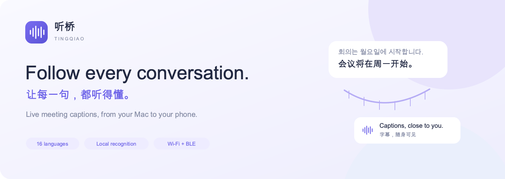
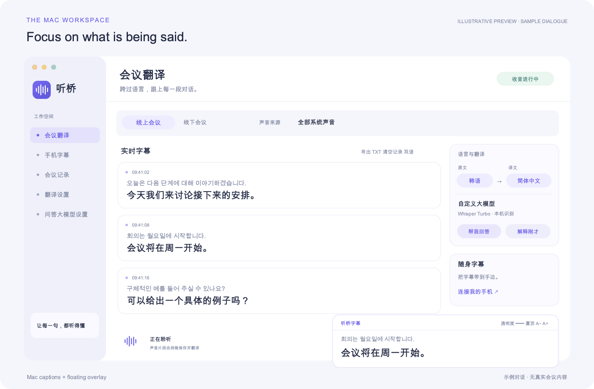
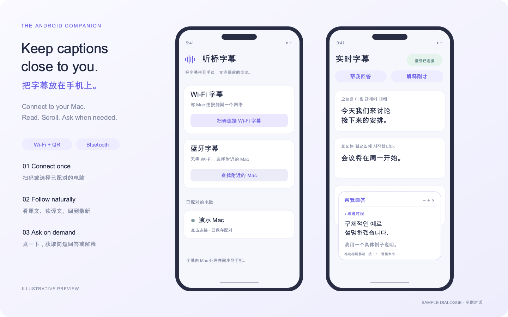

  

  <a href="README.md">English</a> ·
  <a href="README.zh-CN.md"><strong>简体中文</strong></a> ·
  <a href="#从源码构建">源码构建</a> ·
  <a href="docs/PRIVACY.md">隐私说明</a>

  
  
  
  

**听桥 TingQiao** 是一款面向课堂与会议的实时字幕工具。它将麦克风或会议软件播放的语音识别成文字，按你选择的语言翻译，并把字幕显示在 Mac 桌面或安卓手机上。

**TingQiao brings live, bilingual captions to meetings and classes, on your Mac and Android phone.**

  

*文档配图为界面示意，使用虚构对话。配对信息与 API 设置也使用演示内容。*

## 为课堂与会议准备

| 功能 | 能做什么 |
| --- | --- |
| **线上与线下收音** | 线上读取系统或指定应用的声音，线下选择电脑、USB 或蓝牙麦克风。 |
| **16 种语言可选** | 原文和译文分别选择。Whisper 的多种语言共用一份模型。 |
| **两种识别引擎** | Apple 系统识别，或通过 whisper.cpp + Metal 在本机运行 Whisper large-v3-turbo。 |
| **自由选择翻译服务** | 谷歌免 Key 试用接口、Google Cloud、Index-Translate，以及兼容 Chat Completions 的自定义接口。 |
| **结合上文翻译** | 可参考前面 1–6 段原文和已有译文，当前字幕只显示本段的翻译。 |
| **桌面悬浮字幕** | 多句历史滚动、回到最新、透明度、始终置顶、独立字号和窗口缩放。 |
| **手机随身字幕** | Wi-Fi 扫码或蓝牙直连，支持记住多台电脑的配对。 |
| **点一下再问答** | 「帮我回答」「解释刚才」参考最近 15 段正式字幕，回复上限可设为 1–3 句，模型返回的思考过程可折叠。 |
| **整理会议记录** | 本机历史、单条删除、清空与撤销、TXT 导出。待处理音频先保存，再排队识别。 |

### 支持的语言选项

英语、韩语、日语、简体中文、繁体中文、西班牙语、法语、德语、葡萄牙语、意大利语、俄语、阿拉伯语、印地语、印尼语、越南语、泰语。

Apple 识别范围取决于系统和语言资源。在「翻译设置 → 语音识别」中，可以检查当前语言支持、打开系统语言设置。macOS 26 的新识别引擎若缺少当前资源，可点按钮手动下载。Whisper 切换语言共用已经下载的模型。

## 把字幕放在手机上

  

- **Wi-Fi 连接**。在 Mac 开启手机字幕，再用安卓 App 扫码或粘贴完整配对链接。手机浏览器也可以打开链接。
- **蓝牙连接**。在 Mac 开启蓝牙字幕，手机允许「附近设备」后选择电脑。首次输入六位配对码，成功后保存设备专属凭据，支持记住多台电脑。
- **手机问答**。点「帮我回答」或「解释刚才」，通过 Mac 设置的接口请求回复。手机里的回复浮窗可以移动、放大和缩小。
- **前台阅读**。手机请保持字幕页面在前台。锁屏、后台回收或超出蓝牙范围后，连接表现由设备和系统共同决定。

安卓 App 用于连接、阅读字幕和发起问答。识别、翻译请求、API 密钥与会议记录由 Mac 管理。

## 用一分钟认识听桥

新版提供 5 步简短引导，介绍收音、识别、翻译、随身字幕和会议助手。点「下一步」会打开对应菜单并定位设置，随时可以跳过或退出。顶部「使用引导」和帮助菜单都能重新打开。

推荐从 **Whisper large-v3-turbo 本机识别 + 模力方舟 Hy-MT2-30B-A3B 自定义翻译**开始，翻译参考前 4 段，在成本与效果间取得平衡。个人用量参考约 **2 小时 0.1 元**，实际按 Token 和平台价格计费，受发言量与上文长度影响。[查看模型与价格](https://ai.gitee.com/serverless-api?model=Hy-MT2-30B-A3B)

「帮我回答」「解释刚才」使用单独的通用对话模型，例如 DeepSeek，建议先选低思考、最多 3 句。会议助手密钥保存后，返回设置页会显示固定星号与已保存状态，真实密钥留在钥匙串。

## 开始使用

1. 打开听桥，选择「线上会议」或「线下会议」。
2. 选择声音来源、原文语言和译文语言。
3. 在「翻译设置」选择识别引擎和翻译服务。使用 Whisper 时，首次下载或导入约 **1.6 GB** 的模型。
4. 自定义接口需填写地址、模型名称和 API Key。「问答大模型设置」有独立配置。
5. 点击「开始翻译」，按系统提示允许相关权限。
6. 按需开启悬浮字幕，或连接安卓手机。

线上模式通过 ScreenCaptureKit 读取播放声音，会议软件继续使用原来的麦克风和扬声器。软件无需虚拟声卡。线上只取播放音频，线下只取所选麦克风，避免两路音频同时进入造成重复字幕。当前未提供双路声学回声消除。

## 从源码构建

本仓库包含 **Mac 0.2.15** 和 **Android 0.3.2** 源码。

### Mac

需要 Apple 芯片 Mac、macOS 14 或更新系统、较新的 Swift 工具链、Command Line Tools、CMake 3.20+ 和 Python 3。源码使用了新语音接口，**编译需要 macOS 26 SDK 或更新版本**。运行在较旧系统时使用旧版 Apple 识别接口。

~~~sh
git clone https://github.com/oswin-creator/tingqiao-realtime-translation.git
cd tingqiao-realtime-translation
xcode-select --install
# 使用 Homebrew 时：
brew install cmake python
zsh build-whisper.sh
zsh build.sh
open build/听桥.app
~~~

首次构建会下载固定版本的 whisper.cpp 并核对版本。选择 Apple 识别时可使用系统已有资源，Whisper 模型可在 App 里按需下载或导入。

本机构建默认采用 ad-hoc 签名。如有 Apple 开发签名，可通过 TINGQIAO_SIGN_IDENTITY 指定。重新构建后，系统可能要求重新授权。仓库不包含 Developer ID 签名和公证服务。

### 安卓字幕 App

当前脚本在 macOS 上使用 JDK 17、Android SDK Platform 35 和 Build Tools 36.0.0，直接调用 Android 构建工具。

~~~sh
export ANDROID_SDK_ROOT="$HOME/Library/Android/sdk"
zsh android/build.sh
~~~

脚本会从 Maven Central 获取 ZXing Core 3.5.3 并校验 SHA-256。输出为 **android/build/听桥字幕.apk**。预览签名密钥在忽略的构建目录里生成，脚本里的通用开发密码仅供该测试密钥使用。正式分发时请保管好自己的签名密钥。

### 运行测试

~~~sh
zsh test.sh
~~~

测试使用临时数据目录、合成音频、模拟接口和本机回环端口。Java 协议测试需要 JDK 17。安卓设备测试代码在 android/tests，构建手机端后，可用 **zsh android/test-device.sh** 打包测试组件。

目录结构、依赖版本和测试边界见[开发说明](docs/DEVELOPMENT.md)。

## 数据与隐私

- API Key 保存在 **macOS 钥匙串**，手机协议不会返回密钥。
- Apple 本机识别和 Whisper 在 Mac 处理音频。主动选择 Apple 在线识别后，音频可能发送给 Apple。
- 翻译会把正式原文发送给选定服务。开启上下文时，会额外发送前文及已有译文。
- 点问答按钮时，才向独立配置的问答接口发送最多 15 段正式字幕。
- 记录和待处理音频保存在 **~/Library/Application Support/TingQiao/**。成功识别并保存文字后，对应音频会删除。
- Wi-Fi 字幕采用**局域网 HTTP**，配对链接包含凭据，请在可信网络中使用。蓝牙采用加密 GATT 特征和应用配对凭据。
- 这份公开源码已排除个人设置、会议记录、配对数据、真实对话截图、个人设备测试报告与签名产物。

更多细节见[隐私说明](docs/PRIVACY.md)与[安全反馈方式](SECURITY.md)。

## 当前边界

项目仍为测试版。嘈杂环境、多人同时说话或远距离收音可能造成漏字、断句问题和识别幻觉。异常恢复能处理部分中断，系统休眠和未收到的音频仍可能导致缺失。Whisper 会增加内存和用电。

谷歌免 Key 接口、Index 公共服务可能变化或限流。自定义模型的翻译质量、语言对支持、接口兼容性和费用由服务商决定。实际延迟包含断句等待、识别、网络和翻译时间。

目前提供 Mac 与安卓配套，暂未实现 Windows、iOS、说话人区分或语音朗读同传。[验证说明](docs/DEVELOPMENT.md#validation)列出了测试覆盖范围。

## 参与开发与许可

欢迎提交问题和范围明确的改进。复现问题请使用合成示例，上传日志与截图前先移除密钥及个人内容。见[贡献说明](CONTRIBUTING.md)。

听桥原创代码采用 [MIT 许可](LICENSE)。whisper.cpp 与 Whisper 模型各自采用 MIT，ZXing Core 采用 Apache-2.0。完整第三方许可见 [docs/licenses](docs/licenses)，应用包内也附有相关声明。
