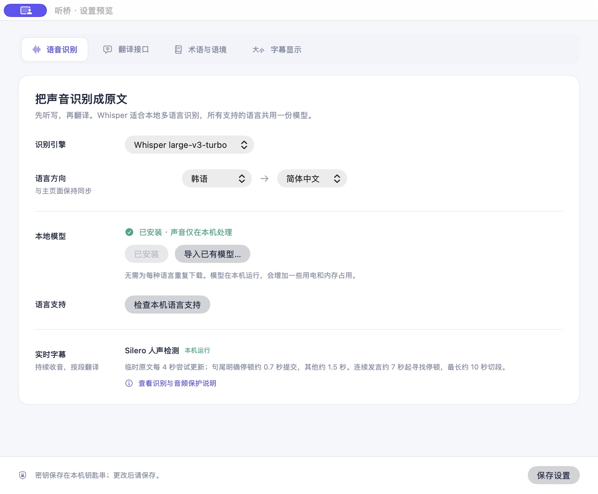

# 听桥 TingQiao 0.2.29

## 更新内容 / What’s new

- 新增 Whisper Medium KomixV2（韩语）、Whisper Large V3 和 Qwen3-ASR-1.7B；与现有 Turbo 一样按需下载，显示安装提示、来源与校验结果，可单独移除。
- 修复 KomixV2 的韩语编码乱码。已有文件首次使用自动修复，保留识别权重，无需重新下载；新下载直接使用正确编码。
- 修复模型下载进度不动的问题，显示已下载大小与百分比。
- 强切后下一段附带前面 1.5 秒音频；结合时间信息去重。连续短语异常先复核一次，保留正常字幕与待处理音频。
- 内置 14,160 个 Wikidata 专业概念并补充统计学、双重差分词汇；每次开始收音前可多选专业领域，保留导入与导出。
- 会议助手参考最近五分钟背景，逐个回答最近十五段的问题；使用提问语言回答并附目标语言译文。解释功能只解释最近十五段。
- 改善窗口自适应布局，悬浮窗透明度仅影响底纹，文字保持清晰。
- 安卓随身字幕保持 0.3.2，无需重复更新手机。

Five recognition engines, on-demand model installation and removal, KomixV2 byte-encoding repair, working download progress, bounded recognition review, a larger offline glossary, and meeting-aware assistant answers. Existing KomixV2 files repair locally without downloading weights again. Android remains 0.3.2.

## 下载 / Downloads

- **Mac 0.2.29**：下载 DMG，适用于 Apple 芯片、macOS 14+，打开后拖入应用程序。
- **Android 0.3.2**：下载 APK，适用于 Android 8+。同一 Wi-Fi 下也可直接用手机浏览器扫码看字幕，无需 App。
- **SHA256SUMS.txt**：安装包校验值。

本地语音识别模型权重不包含在安装包内，请在软件中选择并下载。Mac 预览包采用 ad-hoc 签名，尚未经过 Apple 公证。[安装说明](https://github.com/oswin-creator/tingqiao-realtime-translation/blob/main/docs/INSTALL.md)。

Download the DMG for Apple silicon macOS 14+ or the APK for Android 8+. The Mac preview is ad-hoc signed and not Apple-notarized. Local speech weights are installed separately. No personal API keys, settings, pairing credentials, recordings, or transcripts are included.

## 验证 / Validation

- 公开源码回归检查覆盖识别、断句、记录、问答、蓝牙/二维码协议和词库。
- KomixV2 编码与修复检查验证全部权重字节不变；同一段合成韩语修复前的 14 个乱码替换符在修复后消失。
- Large V3、Turbo 的韩语识别复核通过。安装包单独验证签名、文件清单与隐私排除。

